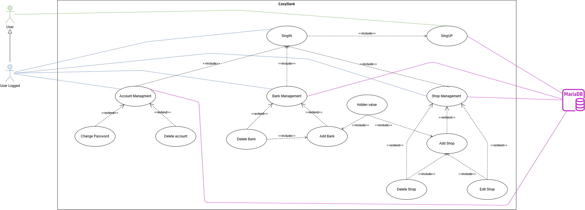\
*Use Case Diagram*

# Indice

- [UC-01 – Sign Up](#uc-01--sign-up)
- [UC-02 – Sign In](#uc-02--sign-in)
- [UC-03 – Add Shop](#uc-03--add-shop)
- [UC-04 – Edit Shop](#uc-04--edit-shop)
- [UC-05 – Delete Shop](#uc-05--delete-shop)
- [UC-06 – Delete Bank](#uc-06--delete-bank)
- [UC-07 – Add New Bank](#uc-07--add-new-bank)
- [UC-08 – Change Password](#uc-08--change-password)
- [UC-09 – Delete Account](#uc-09--delete-account)

---

---

  
  

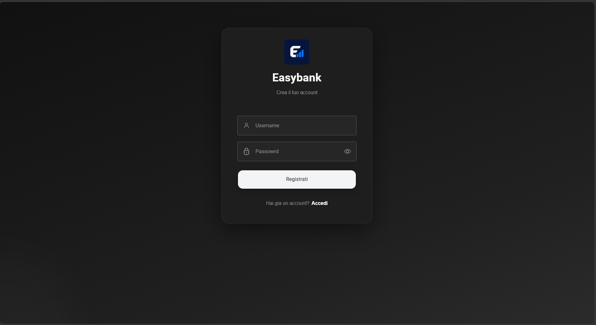\
*Schermata di Sign Up*
 
# UC-01 – Sign Up
 
## Informazioni Generali
 
| Campo | Valore |
|--------|---------|
| **ID** | UC-01 |
| **Nome** | Sign Up |
| **Attore Primario** | User Logged |
| **Attori Secondari** | Database |
| **Priorità** | Alta |
| **Livello** | User Goal |
| **Trigger** | L'utente seleziona la funzione **Registrati** |
 
---
 
  
 
## Descrizione
 
L'utente crea un nuovo account per poter utilizzare l'applicazione.
 
---
 
  
 
## Precondizioni
 
- L'applicazione è in esecuzione.
- L'utente non è autenticato.
---
 
  
 
## Postcondizioni
 
### Successo
 
- L'account è stato creato.
- L'utente è autenticato.
- Viene mostrata la Home.
### Fallimento
 
- L'utente rimane nella schermata di Sign Up.
- Viene visualizzato un messaggio di errore.
---
 
  
 
## Flusso Principale
 
| Passo | Azione |
|--------|---------|
| 1 | L'utente apre la schermata di Sign Up. |
| 2 | Il sistema mostra il modulo di registrazione. |
| 3 | L'utente inserisce username e password. |
| 4 | L'utente preme **Registrati**. |
| 5 | Il sistema verifica che la password rispetti i criteri di sicurezza. |
| 6 | Il sistema verifica che lo username non sia già utilizzato. |
| 7 | Il sistema crea il nuovo account. |
| 8 | Il sistema autentica l'utente. |
| 9 | Il sistema mostra la Home. |
 
---
 
  
 
## Flussi Alternativi
 
### A1 - Password non conforme ai criteri
 
| Passo | Azione |
|--------|---------|
| 5.1 | La password non rispetta i criteri richiesti. |
| 5.2 | Il sistema mostra un messaggio di errore. |
| 5.3 | L'utente può modificare la password e riprovare. |
 
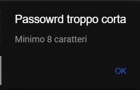\
*Messaggio d'errore*
 
---
 
  
 
### A2 - Username già esistente
 
| Passo | Azione |
|--------|---------|
| 6.1 | Lo username è già utilizzato. |
| 6.2 | Il sistema mostra un messaggio di errore. |
| 6.3 | Il sistema rimane nella schermata di registrazione. |
| 6.4 | L'utente può modificare lo username oppure effettuare il Sign In. |
 
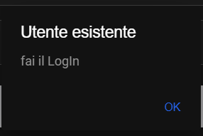\
*Messaggio d'errore*
 
---
 
  
 
## Eccezioni
 
- Database non raggiungibile.
- Server non disponibile.
- Timeout della richiesta.
---
 
  
 
## Requisiti soddisfatti
 
- RF-01 Registrazione utente
  
  
 
---
 
---
 
  
  
 
# UC-02 – Sign In
 
## Informazioni Generali
 
| Campo | Valore |
|--------|---------|
| **ID** | UC-02 |
| **Nome** | Sign In |
| **Attore Primario** | User    |
| **Attori Secondari** | Database |
| **Priorità** | Alta |
| **Livello** | User Goal |
| **Trigger** | L'utente seleziona la funzione **Accedi** |
 
---
 
  
 
## Descrizione
 
L'utente accede all'applicazione utilizzando le proprie credenziali.
 
---
 
  
 
## Precondizioni
 
- L'applicazione è in esecuzione.
- L'utente possiede un account.
- L'utente non è autenticato.
---
 
  
 
## Postcondizioni
 
### Successo
 
- L'utente è autenticato.
- Viene mostrata la Home.
### Fallimento
 
- L'utente rimane nella schermata di Sign In.
---
 
  
 
## Flusso Principale
 
| Passo | Azione |
|--------|---------|
| 1 | L'utente apre la schermata di Sign In. |
| 2 | Il sistema mostra il modulo di autenticazione. |
| 3 | L'utente inserisce username e password. |
| 4 | L'utente preme **Accedi**. |
| 5 | Il sistema verifica le credenziali. |
| 6 | Il sistema autentica l'utente. |
| 7 | Il sistema mostra la Home. |
 
---
 
  
 
## Flussi Alternativi
 
### A1 - Credenziali non valide
 
| Passo | Azione |
|--------|---------|
| 5.1 | Le credenziali inserite non sono valide. |
| 5.2 | Il sistema mostra un messaggio di errore. |
| 5.3 | L'utente può correggere le credenziali e riprovare. |
 
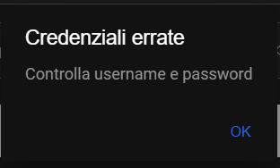\
*Messaggio d'errore*
 
---
 
  
 
## Eccezioni
 
- Database non raggiungibile.
- Server non disponibile.
- Timeout della richiesta.
---
 
  
 
## Requisiti soddisfatti
 
- RF-02 Autenticazione utente.
- RF-03 Gestione della sessione.
  
  
 
---
 
---
 
  
  
 
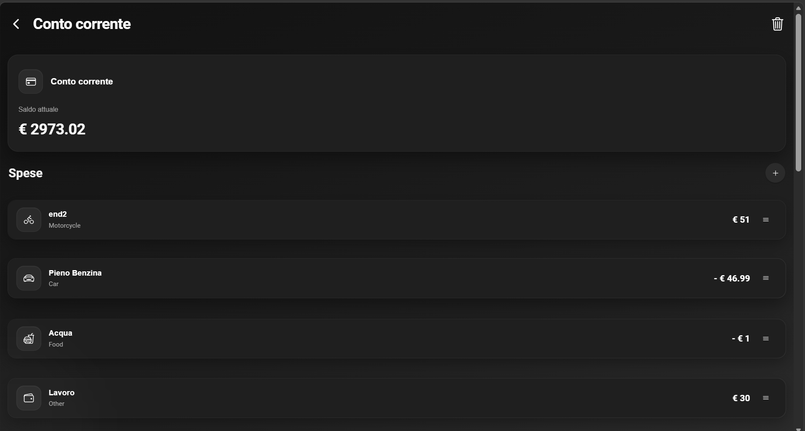 \
*Schermata di un conto*
 
# UC-03 – Add Shop
 
## Informazioni Generali
 
| Campo | Valore |
|--------|---------|
| **ID** | UC-03 |
| **Nome** | Add Shop |
| **Attore Primario** | User Logged |
| **Attori Secondari** | Database |
| **Priorità** | Alta |
| **Livello** | User Goal |
| **Trigger** | L'utente preme il button *+* nella schermata di un conto |
 
---
 
  
 
## Descrizione
 
L'utente aggiunge una nuova spesa in un conto specifico.
 
---
 
  
 
## Precondizioni
 
- L'applicazione è in esecuzione.
- L'utente è autenticato.
- L'utente possiede almeno un conto.
---
 
  
 
## Postcondizioni
 
### Successo
 
- Il valore del conto è incrementato.
- Il valore totale (di tutti i conti) è incrementato.
- La spesa appare per prima nella lista mostrata.
### Fallimento
 
- I valori rimangono gli stessi.
- La spesa non viene aggiunta.
---
 
  
 
## Flusso Principale
 
| Passo | Azione |
|--------|---------|
| 1 | L'utente apre la schermata di un conto. |
| 2 | Preme ***+***. |
| 3 | Il sistema mostra il popup per aggiungere una spesa. |
| 4 | L'utente immette i dati nel form. |
| 5 | Il sistema aggiunge una nuova spesa sul database. |
| 6 | Il sistema mostra la nuova spesa. |
| 7 | Il sistema aggiorna tutti i totali. |
 
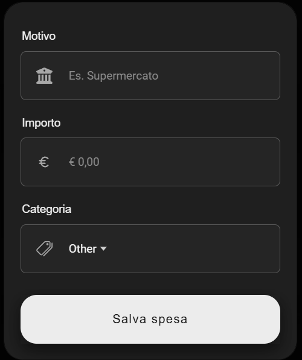 \
*Form per aggiunta Shop*
 
---
 
  
 
## Eccezioni
 
- Database non raggiungibile.
- Server non disponibile.
- Timeout della richiesta.
- Conto non trovato.
---
 
  
 
## Requisiti soddisfatti
 
- RF-01 Integrità delle spese
- RF-02 Gestione delle spese
  
  
 
---
 
---
 
  
  
 
# UC-04 – Edit Shop
 
## Informazioni Generali
 
| Campo | Valore |
|--------|---------|
| **ID** | UC-04 |
| **Nome** | Edit Shop |
| **Attore Primario** | User Logged |
| **Attori Secondari** | Database |
| **Priorità** | Alta |
| **Livello** | User Goal |
| **Trigger** | L'utente preme l'icona "*menu*" e poi su ***salva*** |
 
---
 
  
 
## Descrizione
 
L'utente modifica uno dei dati presenti in una spesa.
 
---
 
  
 
## Precondizioni
 
- L'applicazione è in esecuzione.
- L'utente è autenticato.
- L'utente possiede almeno un conto.
- L'utente ha almeno una spesa nel conto.
---
 
  
 
## Postcondizioni
 
### Successo
 
- La spesa viene aggiornata con i nuovi valori.
- Il valore del conto viene modificato.
- Il valore totale viene modificato.
### Fallimento
 
- Il valore del conto e il valore totale rimangono invariati.
- Lo stato della spesa rimane invariato.
---
 
  
 
## Flusso Principale
 
| Passo | Azione |
|--------|---------|
| 1 | L'utente apre la schermata di un conto. |
| 2 | Preme sull'icona ***Menu***. |
| 3 | Il sistema mostra un form con i dati della spesa. |
| 4 | L'utente sceglie i campi che vuole modificare. |
| 5 | Preme sull'icona ***Salva***. |
| 6 | Il sistema carica i nuovi valori sul database. |
| 7 | Il sistema aggiorna il valore della shop card. |
| 8 | Il sistema mostra la spesa con i dati cambiati. |
| 9 | Il sistema aggiorna tutti i totali. |
 
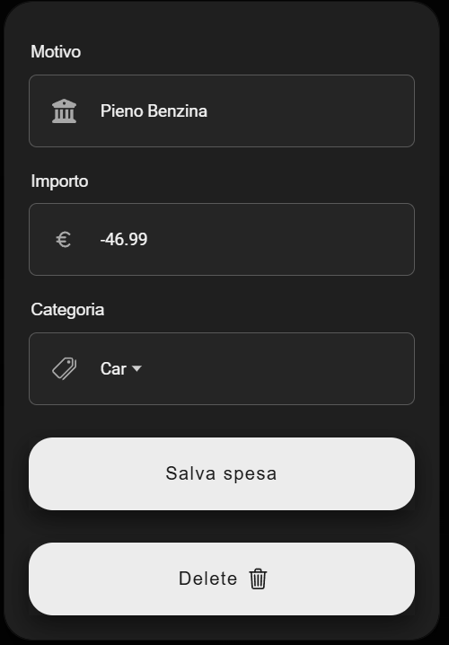 \
*Form con i dati della spesa*
 
---
 
  
 
## Eccezioni
 
- Database non raggiungibile.
- Server non disponibile.
- Timeout della richiesta.
- Spesa non trovata.
---
 
  
 
## Requisiti soddisfatti
 
- RF-01 Integrità dei valori
- RF-02 Gestione delle spese
  
  
 
---
 
---
 
  
  
 
# UC-05 – Delete Shop
 
## Informazioni Generali
 
| Campo | Valore |
|--------|---------|
| **ID** | UC-05 |
| **Nome** | Delete Shop |
| **Attore Primario** | User Logged |
| **Attori Secondari** | Database |
| **Priorità** | Alta |
| **Livello** | User Goal |
| **Trigger** | L'utente preme l'icona "*menu*" e poi su "*delete*" |
 
---
 
  
 
## Descrizione
 
L'utente elimina una spesa.
 
---
 
  
 
## Precondizioni
 
- L'applicazione è in esecuzione.
- L'utente è autenticato.
- L'utente possiede almeno un conto.
- L'utente ha almeno una spesa nel conto.
---
 
  
 
## Postcondizioni
 
### Successo
 
- La spesa viene eliminata.
- Il valore del conto viene modificato.
- Il valore totale viene modificato.
### Fallimento
 
- Il valore del conto e il valore totale rimangono invariati.
- La spesa non viene eliminata.
---
 
  
 
## Flusso Principale
 
| Passo | Azione |
|--------|---------|
| 1 | L'utente apre la schermata di un conto. |
| 2 | Preme sull'icona ***Menu***. |
| 3 | Il sistema mostra un form con i dati della spesa. |
| 4 | L'utente preme sul button ***delete***. |
| 5 | Il sistema elimina la spesa dal database. |
| 6 | Il sistema aggiorna la lista delle spese. |
| 7 | Il sistema aggiorna tutti i totali. |
 
 \
*Form con i dati della spesa*
 
---
 
  
 
## Eccezioni
 
- Database non raggiungibile.
- Server non disponibile.
- Timeout della richiesta.
- Spesa non trovata.
---
 
  
 
## Requisiti soddisfatti
 
- RF-01 Integrità dei valori
- RF-02 Gestione delle spese
  
  
 
---
 
---
 
  
  
 
\
*Schermata Bank*
 
# UC-06 – Delete Bank
 
## Informazioni Generali
 
| Campo | Valore |
|--------|---------|
| **ID** | UC-06 |
| **Nome** | Delete Bank |
| **Attore Primario** | User Logged |
| **Attori Secondari** | Database |
| **Priorità** | Alta |
| **Livello** | User Goal |
| **Trigger** | L'utente seleziona l'azione **Delete** relativa a un conto. |
 
---
 
  
 
## Descrizione
 
L'utente elimina un conto esistente.
 
---
 
  
 
## Precondizioni
 
- L'applicazione è in esecuzione.
- L'utente è autenticato.
- L'utente possiede almeno un conto.
---
 
  
 
## Postcondizioni
 
### Successo
 
- Il conto è eliminato.
- Il saldo totale è aggiornato.
- Viene mostrata la Home.
### Fallimento
 
- Il conto non viene eliminato.
- I saldi rimangono invariati.
- L'utente rimane nella schermata del conto.
---
 
  
 
## Flusso Principale
 
| Passo | Azione |
|--------|---------|
| 1 | L'utente apre la schermata di un conto. |
| 2 | L'utente seleziona **Delete**. |
| 3 | Il sistema mostra una finestra di conferma. |
| 4 | L'utente seleziona **Sì**. |
| 5 | Il sistema elimina il conto dal database. |
| 6 | Il sistema aggiorna il saldo totale. |
| 7 | Il sistema mostra la Home. |
 
\
*Finestra di conferma eliminazione*
 
---
 
  
 
## Flussi Alternativi
 
### A1 - L'utente seleziona **No**
 
| Passo | Azione |
|--------|---------|
| 4.1 | L'utente seleziona **No**. |
| 4.2 | Il sistema chiude la finestra di conferma. |
| 4.3 | Il conto non viene eliminato. |
| 4.4 | L'utente può continuare a utilizzare l'applicazione. |
 
---
 
  
 
## Eccezioni
 
- Database non raggiungibile.
- Server non disponibile.
- Timeout della richiesta.
- Conto non trovato.
---
 
  
 
## Requisiti soddisfatti
 
- RF-01 Integrità dei dati.
- RF-02 Gestione dei conti.
  
  
 
---
 
---
 
  
  
 
# UC-07 – Add New Bank
 
## Informazioni Generali
 
| Campo | Valore |
|--------|---------|
| **ID** | UC-07 |
| **Nome** | Add New Bank |
| **Attore Primario** | User Logged |
| **Attori Secondari** | Database |
| **Priorità** | Alta |
| **Livello** | User Goal |
| **Trigger** | L'utente seleziona l'azione ***+*** nella schermata Home. |
 
> [!NOTE]
> Nota: il trigger di questa funzione è presente nella schermata Home.
 
---
 
  
 
## Descrizione
 
L'utente aggiunge un nuovo conto al proprio account.
 
---
 
  
 
## Precondizioni
 
- L'applicazione è in esecuzione.
- L'utente è autenticato.
- Non esiste già un conto con lo stesso nome.
---
 
  
 
## Postcondizioni
 
### Successo
 
- Il nuovo conto viene creato.
- Il saldo totale viene aggiornato.
- La lista dei conti viene aggiornata.
### Fallimento
 
- Nessun nuovo conto viene creato.
- I dati rimangono invariati.
---
 
  
 
## Flusso Principale
 
| Passo | Azione |
|--------|---------|
| 1 | L'utente seleziona ***+***. |
| 2 | Il sistema mostra il form di creazione del conto. |
| 3 | L'utente inserisce il nome del conto e il saldo iniziale. |
| 4 | L'utente preme **Crea Conto**. |
| 5 | Il sistema verifica che non esista già un conto con lo stesso nome. |
| 6 | Il sistema crea il nuovo conto nel database. |
| 7 | Il sistema aggiorna il saldo totale. |
| 8 | Il sistema aggiorna la lista dei conti. |
| 9 | Il sistema mostra la Home. |
 
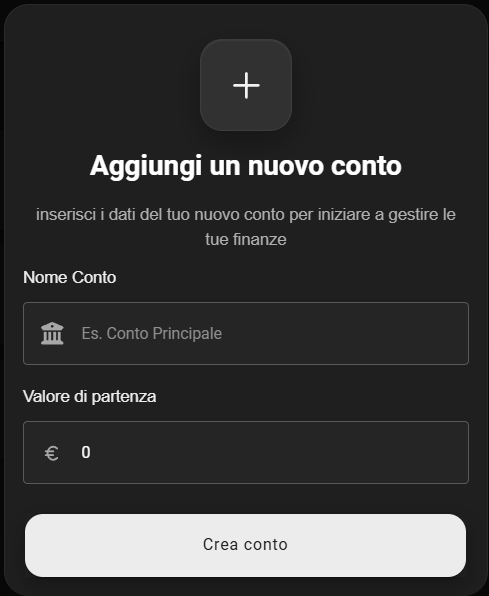\
*Form per aggiungere un nuovo conto*
 
---
 
  
 
## Flussi Alternativi
 
### A1 - Esiste già un conto con lo stesso nome
 
| Passo | Azione |
|--------|---------|
| 5.1 | Il sistema rileva che esiste già un conto con lo stesso nome. |
| 5.2 | Il sistema mostra un messaggio di errore. |
| 5.3 | Il sistema mantiene aperto il modulo di creazione del conto. |
| 5.4 | L'utente può modificare il nome del conto e riprovare. |
 
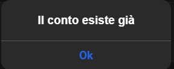\
*Messaggio d'errore*
 
---
 
  
 
## Eccezioni
 
- Database non raggiungibile.
- Server non disponibile.
- Timeout della richiesta.
- Utente non trovato.
---
 
  
 
## Requisiti soddisfatti
 
- RF-01 Integrità dei dati.
- RF-02 Gestione dei conti.
  
  
 
---
 
---
 
  
  
 
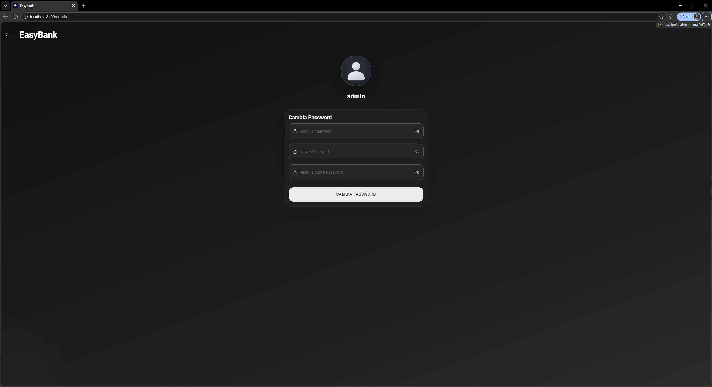\
*Schermata di User page*
 
# UC-08 – Change Password
 
## Informazioni Generali
 
| Campo | Valore |
|--------|---------|
| **ID** | UC-08 |
| **Nome** | Change Password |
| **Attore Primario** | User Logged |
| **Attori Secondari** | Database |
| **Priorità** | Alta |
| **Livello** | User Goal |
| **Trigger** | L'utente preme il tasto **Cambia password**. |
 
---
 
  
 
## Descrizione
 
L'utente può modificare la password associata al proprio account.
 
---
 
  
 
## Precondizioni
 
- L'applicazione è in esecuzione.
- L'utente è autenticato.
---
 
  
 
## Postcondizioni
 
### Successo
 
- La password dell'utente viene aggiornata nel database.
- L'utente viene disconnesso dalla sessione corrente.
### Fallimento
 
- L'utente rimane nella schermata di User.
- Il sistema visualizza un messaggio di errore.
---
 
  
 
## Flusso Principale
 
| Passo | Azione |
|--------|---------|
| 1 | L'utente accede alla schermata di User. |
| 2 | Inserisce la password corrente, la nuova password e la relativa conferma. |
| 3 | Seleziona **Cambia password**. |
| 4 | Il sistema verifica che la nuova password soddisfi i requisiti previsti. |
| 5 | Il sistema verifica che la conferma della nuova password corrisponda alla password inserita. |
| 6 | Il sistema verifica che la password corrente sia corretta. |
| 7 | Il sistema aggiorna la password nel database. |
| 8 | Il sistema termina la sessione dell'utente effettuando il logout. |
 
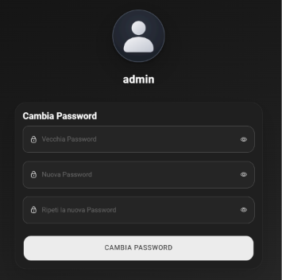\
*Form per cambiare password*
 
---
 
  
 
## Flussi Alternativi
 
### A1 - Password nuova non rispetta i parametri
 
| Passo | Azione |
|--------|---------|
| 4.1 | La nuova password non soddisfa i requisiti previsti. |
| 4.2 | Il sistema visualizza un messaggio di errore. |
| 4.3 | Il sistema svuota i campi relativi alla nuova password e alla conferma della password. |
| 4.4 | Il sistema evidenzia in rosso i campi non validi. |
| 4.5 | L'utente può inserire nuovamente i dati. |
 
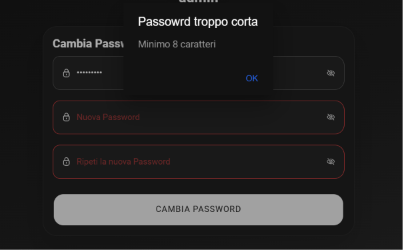\
*Messaggio d'errore*
 
---
 
### A2 - Password non viene ripetuta in modo uguale
 
| Passo | Azione |
|--------|---------|
| 5.1 | La conferma della nuova password non corrisponde alla password inserita. |
| 5.2 | Il sistema svuota il campo di conferma della password. |
| 5.3 | Il sistema evidenzia in rosso il campo di conferma. |
| 5.4 | Il sistema rende visibile la nuova password per agevolare la verifica da parte dell'utente. |
| 5.5 | L'utente può riprovare. |
 
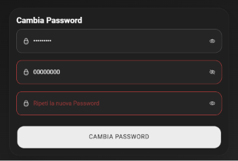\
*Form evidenziata per errore*
 
---
 
### A3 - Password vecchia non corretta
 
| Passo | Azione |
|--------|---------|
| 6.1 | La password corrente inserita non è corretta. |
| 6.2 | Il sistema svuota tutti i campi del modulo. |
| 6.3 | Il sistema evidenzia in rosso il campo della password corrente. |
| 6.4 | L'utente può riprovare. |
 
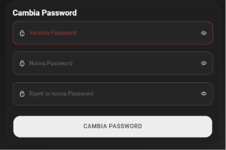\
*Form evidenziata per errore*
 
---
 
  
 
## Eccezioni
 
- Database non raggiungibile.
- Server non disponibile.
- Timeout della richiesta.
---
 
  
 
## Requisiti soddisfatti
 
- RF-01 Integrità dei dati.
  
  
 
---
 
---
 
  
  
 
# UC-09 – Delete Account
 
## Informazioni Generali
 
| Campo | Valore |
|--------|---------|
| **ID** | UC-09 |
| **Nome** | Delete Account |
| **Attore Primario** | User Logged |
| **Attori Secondari** | Database |
| **Priorità** | Alta |
| **Livello** | User Goal |
| **Trigger** | L'utente seleziona **Delete Account**. |
 
---
 
  
 
## Descrizione
 
L'utente può eliminare definitivamente il proprio account e tutti i dati ad esso associati.
 
---
 
  
 
## Precondizioni
 
- L'applicazione è in esecuzione.
- L'utente è autenticato.
---
 
  
 
## Postcondizioni
 
### Successo
 
- Il sistema elimina definitivamente l'account e tutti i dati associati.
- L'utente viene reindirizzato alla schermata di login.
### Fallimento
 
- L'utente rimane nella schermata corrente.
- Il sistema visualizza un messaggio di errore, se necessario.
---
 
  
 
## Flusso Principale
 
| Passo | Azione |
|--------|---------|
| 1 | L'utente accede alla schermata **User**. |
| 2 | Seleziona **Delete Account**. |
| 3 | Il sistema richiede l'inserimento della password. |
| 4 | L'utente inserisce la password. |
| 5 | Il sistema verifica la correttezza della password. |
| 6 | Il sistema visualizza un messaggio di conferma dell'operazione. |
| 7 | L'utente seleziona **Sì**. |
| 8 | Il sistema elimina definitivamente l'account e i relativi dati dal database. |
| 9 | Il sistema reindirizza l'utente alla schermata di login. |
 
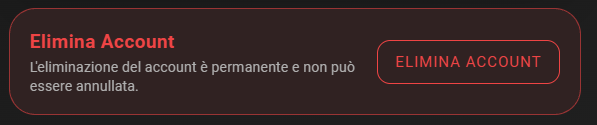\
*Button per delete*
 
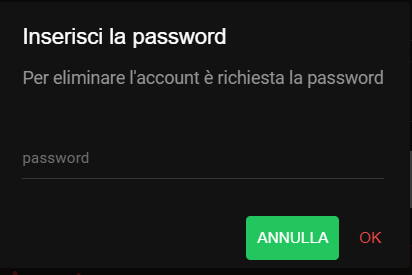\
*Form richiesta password*
 
\
*Messaggio di conferma*
 
---
 
  
 
## Flussi Alternativi
 
### A1 - Password errata
 
| Passo | Azione |
|--------|---------|
| 5.1 | La password inserita non è corretta. |
| 5.2 | Il sistema visualizza un messaggio di errore. |
| 5.3 | L'utente può inserire nuovamente la password. |
 
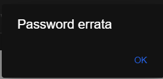\
*Messaggio d'errore*
 
---
 
### A2 - L'utente annulla l'operazione
 
| Passo | Azione |
|--------|---------|
| 7.1 | L'utente seleziona **No**. |
| 7.2 | Il sistema chiude la finestra di conferma. |
| 7.3 | L'utente rimane nella schermata **User**. |
 
---
 
  
 
## Eccezioni
 
- Database non raggiungibile.
- Server non disponibile.
- Timeout della richiesta.
---
 
  
 
## Requisiti soddisfatti
 
- RF-01 Integrità dei dati.
  
  
 
---
 
---
 
  
  
 
Licenza <a href="https://creativecommons.org/licenses/by-nc-sa/4.0/deed.it">CC BY-NC-SA 4.0</a>
